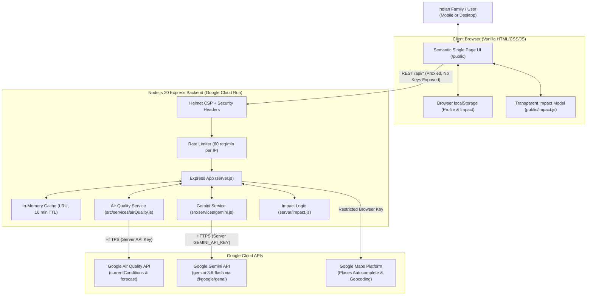

# Saans (साँस) - GenAI Urban Air Quality Assistant

> **A production-ready, dependency-light web application tailored for Indian families navigating severe winter smog, thermal inversions, and toxic urban air pollution.**

[](https://nodejs.org/)
[](LICENSE)
[]()
[]()

---

## 1. The Problem

Every winter, millions of households across northern and central India (Delhi NCR, Mumbai, Kolkata, Lucknow, Kanpur, Patna) face an acute air pollution crisis. Several compounding factors trigger hazardous air quality:

1. **Meteorological Temperature Inversion**: Cold winter nights and mornings create a dense ground-level boundary layer that traps vehicular emissions, stubble burning smoke, and industrial particulate matter within 50 meters of the surface.
2. **Extreme Particulate Exposure**: Daily $\text{PM}_{2.5}$ concentrations regularly spike between $250\text{--}600\ \mu\text{g/m}^3$ (10 to 40 times above safe WHO guidelines).
3. **Unsealed Residential Construction**: Most urban Indian apartments have loose balcony sliding doors, unsealed windows, and threshold gaps that allow heavy outdoor smog to penetrate living quarters.
4. **Compounding Indoor Emissions**: Everyday practices like frying and high-heat *tadka*, burning incense (*agarbatti* or *dhoop*), and dry broom sweeping (*jhadu*) resuspend toxic particles, creating indoor AQI levels that can exceed outdoor street air.
5. **Generic, Impractical Advice**: Families are often told to "stay indoors", which is impossible for working citizens, students, and households without commercial $\text{HEPA}$ air purifiers.

**Saans (साँस)** solves this by offering hyper-practical, timed routine adjustments, zero-cost indoor air protection hacks, sustainable commute alternatives, and transparent impact tracking grounded in Indian city realities.

---

## 2. What Saans Does

* **Live National AQI (NAQI) Ring**: High-contrast, color-coded meter displaying real-time Indian NAQI index, dominant pollutant ($\text{PM}_{2.5}$, $\text{PM}_{10}$), and immediate health warnings.
* **Optimal Ventilation Window**: Analyzes the 24-hour diurnal forecast to automatically detect the cleanest 2-3 hour window (typically early afternoon, 1:00 PM - 4:00 PM, when solar warming expands the boundary layer) for brief outdoor errands and cross-ventilation.
* **Localized Household Profile**: Stores sensitive family conditions (infants, elderly, asthma/heart ailments, commute mode, cooking fuel, $\text{HEPA}$ purifiers) strictly in the user's browser `localStorage`, zero profile data is sent to external databases.
* **GenAI Daily Action Plan**: Powered by Gemini (`gemini-3.8-flash`), delivering timed routine shifts, smarter habit alternatives, and high-visibility medical red-flag warnings.
* **Room-by-Room Indoor Hacks**: Low-cost, actionable hacks tailored for Indian homes (damp-towel sliding door seals, *tadka* exhaust isolation, damp microfiber mopping, zero-agarbatti rules).
* **Multilingual Chat Assistant**: Contextual conversation with Saans in English, Hindi (हिंदी), or Marathi (मराठी).
* **Transparent Impact Tracker**: Quantifies weekly avoided exposure hours, prevented $\text{CO}_2$ emissions, and transit fuel savings using transparent mathematical environmental models.

---

## 3. Screenshots

```
+-------------------------------------------------------------------------+
|  Saans (साँस)                       [Live] Delhi NCR                   |
|  [Home]   [Today's Plan]   [Indoor Hacks]   [My Household]   [Impact]   |
+-------------------------------------------------------------------------+
|                                                                         |
|        +-------------------+    Dominant Pollutant: PM2.5               |
|        |       NAQI        |    Health Warning:                         |
|        |        342        |    Avoid morning walks. Seal balcony gaps. |
|        |     Very Poor     |                                            |
|        +-------------------+    [ Generate Action Plan -> ]             |
|                                                                         |
|  24-Hour Smog & Ventilation Forecast   [Best Window: 1:30 PM - 4:00 PM]   |
|  +-------+ +-------+ +-------+ +-------------+ +-------+ +-------+      |
|  | 07:00 | | 09:00 | | 11:00 | | 13:00 (BEST)| | 17:00 | | 21:00 |      |
|  |  410  | |  380  | |  280  | |     185     | |  360  | |  390  |      |
|  +-------+ +-------+ +-------+ +-------------+ +-------+ +-------+      |
+-------------------------------------------------------------------------+
```

*(Place visual interface screenshots in `docs/screenshots/`)*

* **Home & Ventilation Window**: `docs/screenshots/home.png`
* **Today's Action Plan**: `docs/screenshots/plan.png`
* **Indoor Hacks & Impact Tracker**: `docs/screenshots/hacks.png`

---

## 4. Architecture Diagram



---

## 5. Google Services Used & Why

| Service | Component | Why It Was Chosen |
| :--- | :--- | :--- |
| **Google Air Quality API** | `currentConditions:lookup` & `forecast:lookup` | Provides verified real-time local Indian National Air Quality Index (`aqi_in`), dominant pollutant concentrations ($\text{PM}_{2.5}$, $\text{PM}_{10}$), and 24-hour hourly diurnal forecasts. |
| **Google Maps Platform Weather API** | `currentConditions:lookup` | Retrieves temperature, feels-like temperature, humidity, wind velocity, and UV index to evaluate cold-air inversion risks and ground smog trapping. Requires enabling the Google Maps Platform Weather API in your Google Cloud Console. |
| **Google Gemini API** | `@google/genai` (`gemini-3.8-flash`) | Fast, cost-efficient generative reasoning. Uses structured JSON output (`responseMimeType: "application/json"`) to tailor practical daily routines, indoor hacks, and multilingual answers (English, Hindi, Marathi). |
| **Google Maps Platform** | Places Autocomplete & Geocoding | Allows users to search any Indian city, sector, or colony with autocomplete while keeping server keys safe behind the backend proxy. |
| **Google Cloud Run** | Containerized Serverless | Auto-scales to zero, fast cold starts on `node:20-slim`, zero server maintenance, and native binding to Cloud Run's `$PORT`. |

---

## 6. How the Impact Model Works

All numbers shown in the application are computed directly from documented environmental factors in [public/impact.js](public/impact.js) and [server/impact.js](server/impact.js).

### Documented Assumptions
1. **Respiratory Ventilation**: $1.2\text{ m}^3/\text{hour}$ average adult breathing volume during light walking/commuting exertion (WHO/EPA respiratory standards).
2. **$\text{PM}_{2.5}$ Inhalation Mass Avoided**:
   $$\text{Avoided Mass } (\mu\text{g}) = (\text{Peak PM}_{2.5} - \text{Clean PM}_{2.5}) \times 1.2\text{ m}^3/\text{h} \times \text{Duration (h)}$$
3. **Respirator Filtration Efficiency**:
   * Well-fitted certified N95: **95%** particulate capture.
   * Loose or standard mask: **70%** particulate capture.
4. **Indoor Particulate Attenuation**:
   * Closed windows (standard masonry): **35%** reduction (indoor/outdoor ratio $\approx 0.65$).
   * Damp-towel draft sealing: **55%** reduction (indoor/outdoor ratio $\approx 0.45$).
   * Room $\text{HEPA}$ purifier in a closed room: **80%** reduction (indoor/outdoor ratio $\approx 0.20$).
5. **Transport Emissions (BEE India / Delhi Metro DMRC benchmarks)**:
   * Petrol car with AC: $175\text{ g CO}_2/\text{km}$
   * Average petrol car: $160\text{ g CO}_2/\text{km}$
   * Two-wheeler ($100\text{--}150\text{cc}$): $90\text{ g CO}_2/\text{km}$
   * CNG auto-rickshaw: $70\text{ g CO}_2/\text{passenger-km}$
   * Urban bus: $30\text{ g CO}_2/\text{passenger-km}$
   * Electrified Metro: $15\text{ g CO}_2/\text{passenger-km}$
   * Walking / Cycling: $0\text{ g CO}_2/\text{km}$

### Transparent One-Line Explanations
Every displayed metric includes a clear one-line explanation (e.g., *"Shifting a 2.5h walk from morning inversion (NAQI 340) to afternoon (190) reduces direct particulate inhalation by ~44% (saving ~450 µg PM2.5 intake)."*).

> **Non-Medical Disclaimer**: All estimates are mathematical environmental and emission models based on published CPCB, BEE, and WHO factors; they do not constitute medical advice or clinical evaluations.

---

## 7. Security & Accessibility (a11y)

### Security Measures
* **Zero Client-Side Secret Exposure**: All Google Cloud API keys remain strictly in server-side environment variables. The client only receives the restricted browser Maps key via `/api/config`.
* **Strict Content Security Policy (CSP)**: Managed by `helmet`, locking script and connection sources to `'self'`, Google Maps, and Google Fonts.
* **Rate Limiting**: Sliding-window rate limiter enforcing a maximum of 60 requests/minute per IP across `/api/*`.
* **Payload Caps**: Strict 10kb JSON body size limit to thwart flood and denial-of-service attempts.
* **Container Hardening**: Multi-stage `Dockerfile` drops root privileges and executes as non-root user `node`.
* **Safe Error Handling**: The central error handler suppresses stack traces and internal diagnostics from reaching HTTP responses.

### Accessibility (a11y) Standards
* **WCAG 2.1 AA Compliance**: High-contrast typography ($\ge 4.5:1$ body, $\ge 3:1$ large metrics) across both light and dark color schemes.
* **Dual-Cue Severity Coding**: NAQI severity is never indicated by color alone; it is always paired with numerical values, text badges, and descriptive labels.
* **Keyboard Navigable**: Full keyboard support with Arrow-key navigation across navigation tabs and a high-contrast $3\text{px}$ `:focus-visible` outline.
* **Screen Reader Optimization**: Real-time announcements for AQI and chat updates powered by `aria-live="polite"` regions.
* **Reduced Motion**: Respects `prefers-reduced-motion` by disabling CSS animations, progress transitions, and spinning loaders.

---

## 8. How to Run Locally

### Prerequisites
* Node.js $\ge 20.0.0$
* npm $\ge 9.0.0$

### Steps
1. **Clone the repository**:
   ```bash
   git clone https://github.com/your-username/saans.git
   cd saans
   ```

2. **Configure environment variables**:
   ```bash
   cp .env.example .env
   ```
   Open `.env` and insert your API keys:
   ```env
   PORT=8080
   NODE_ENV=development
   GEMINI_API_KEY=your_gemini_api_key_here
   GEMINI_MODEL=gemini-3.8-flash
   GOOGLE_MAPS_API_KEY=your_google_maps_api_key_here
   GOOGLE_MAPS_BROWSER_KEY=your_restricted_browser_maps_key_here
   ```

3. **Install dependencies**:
   ```bash
   npm install
   ```

4. **Start the application**:
   ```bash
   npm start
   ```
   Or for auto-reloading development mode:
   ```bash
   npm run dev
   ```

5. Open [http://localhost:8080](http://localhost:8080) in your web browser.

---

## 9. How to Run Tests & Linter

The test suite runs using Node.js's native test runner (`node:test`) without heavy third-party testing frameworks:

* **Run all 38 automated unit and integration tests**:
  ```bash
  npm test
  ```
* **Run ESLint code style and quality check**:
  ```bash
  npm run lint
  ```
* **Auto-fix lint issues**:
  ```bash
  npm run lint:fix
  ```

---

## 10. How to Deploy to Google Cloud Run

### Option A: Direct Source Deploy (Cloud Build)
```bash
gcloud run deploy saans \
  --source . \
  --region asia-south1 \
  --platform managed \
  --allow-unauthenticated \
  --set-env-vars GEMINI_API_KEY="your_gemini_key",GOOGLE_MAPS_API_KEY="your_maps_key",GEMINI_MODEL="gemini-3.8-flash"
```

### Option B: Build and Deploy Container via Artifact Registry
1. **Build container image locally or via Cloud Build**:
   ```bash
   docker build -t gcr.io/YOUR_PROJECT_ID/saans:v1 .
   docker push gcr.io/YOUR_PROJECT_ID/saans:v1
   ```

2. **Deploy to Cloud Run**:
   ```bash
   gcloud run deploy saans \
     --image gcr.io/YOUR_PROJECT_ID/saans:v1 \
     --region asia-south1 \
     --port 8080 \
     --allow-unauthenticated \
     --set-env-vars GEMINI_API_KEY="your_gemini_key",GOOGLE_MAPS_API_KEY="your_maps_key"
   ```

---

## 11. Repository Cleanliness

* Strict `.gitignore` and `.dockerignore` prevent build caches, test artifacts, and sensitive `.env` files from entering version control or container builds.
* Lightweight zero-framework frontend served directly as static assets from `/public`.
* Total container image weight kept minimal on `node:20-slim`.
